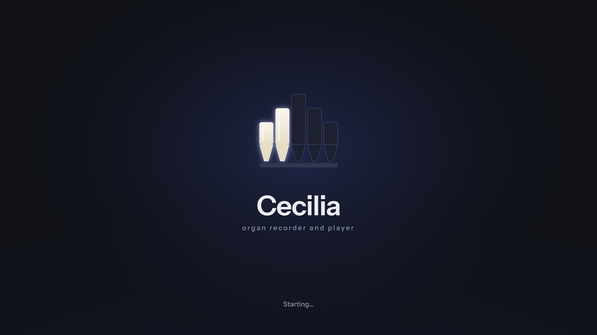
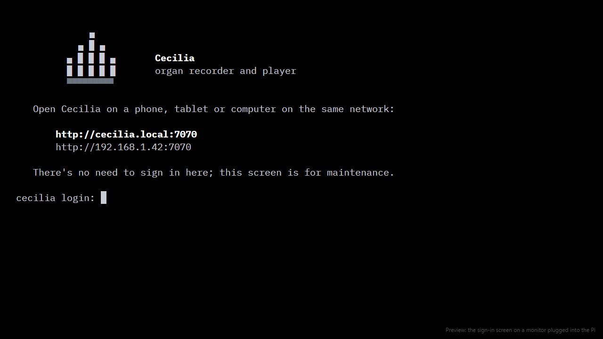
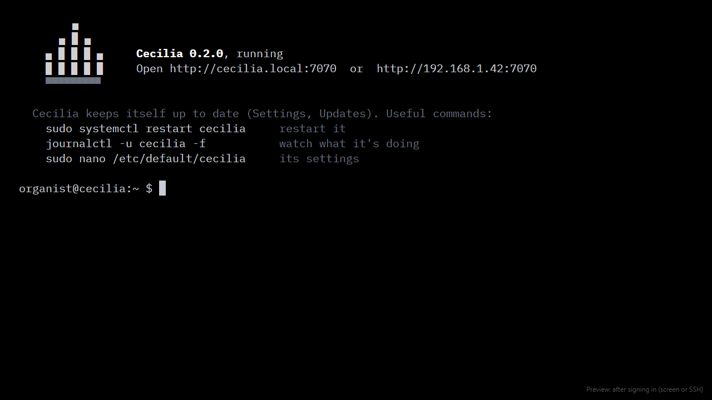

# Cecilia for Raspberry Pi

A ready-to-use SD card image: Raspberry Pi OS Lite (64-bit) with
[Cecilia](https://github.com/garethcheyne/cecilia) installed, branded from
power-on to sign-in, and keeping itself up to date.

## Writing the SD card

**With Raspberry Pi Imager** (version 1.8 or later):

1. Open Imager's options and set the **content repository** to
   `https://garethcheyne.github.io/cecilia-pi/os_list.json`. (Or start it as
   `rpi-imager --repo https://garethcheyne.github.io/cecilia-pi/os_list.json`.)
2. Choose your Pi, then **Cecilia** as the operating system, then the card.
3. When Imager offers **OS customisation**, set your own username and
   password, the church Wi-Fi, and your time zone. Switch on SSH only if
   someone will look after the Pi remotely.
4. Write the card, put it in the Pi and switch on. After a minute or two,
   open **http://cecilia.local:7070** on a phone or tablet on the same
   network, and set a password in Settings.

Or download the `.img.xz` from [Releases](https://github.com/garethcheyne/cecilia-pi/releases)
and choose *Use custom* in Imager.

## What you need

| | Recommended | Also works |
| --- | --- | --- |
| **Pi** | Raspberry Pi 4 Model B, 2 GB or more | Pi 5 (any memory); Pi 3 B+ without screens |
| **Power** | The official USB-C supply for that Pi: 15 W (5.1 V 3 A) for a Pi 4, 27 W (5.1 V 5 A) for a Pi 5 | |
| **Card** | 32 GB, A1 or A2 rated, from a known brand | |
| **MIDI** | A class-compliant USB MIDI interface (Roland UM-ONE mk2, ESI M4U eX), or the organ's own USB port | |
| **Sound** | Only for the simulator: the Pi 4's headphone socket, or a USB sound card on a Pi 5 | |

The Pi 5 has no headphone socket, so it needs a USB sound card (or HDMI audio)
to make sound itself. With a real organ that doesn't matter: the organ makes
the sound.

## What's on the image

- **Raspberry Pi OS Lite (64-bit, Bookworm)**: no desktop.
- **Cecilia**: starts at boot, reachable as `cecilia.local`, and updates
  itself (Settings, Updates). The first package is kept so it can go back.
- **The Cecilia look**:
  - no rainbow square from the firmware, and no scrolling text;
  - a start-up screen whose five pipes light up as the Pi starts
    ("Restarting…", "Shutting down…" and "Installing updates…" too);
  - a sign-in screen with the address to open;
  - a welcome after signing in, with Cecilia's status and useful commands.

| Sign-in screen | After signing in |
| --- | --- |
|  |  |

The very first moment after power-on belongs to the Pi's own firmware; the
image hides its rainbow, and the Cecilia screen takes over as soon as the
system starts.

## How it's built

A [pi-gen](https://github.com/RPi-Distro/pi-gen) stage on top of the standard
Lite stages:

| | |
| --- | --- |
| `stage-cecilia/00-cecilia` | Installs the Cecilia package (checked against its SHA-256), enables its updater |
| `stage-cecilia/01-branding` | The Plymouth start-up theme, quiet boot, sign-in banner and welcome |
| `branding/render.mjs` | Draws the start-up artwork (`node branding/render.mjs`) |
| `branding/preview-console.mjs` | Draws the sign-in previews above |
| `imager/os_list.jq` | The list Raspberry Pi Imager reads |
| `.github/workflows/build.yml` | Builds the image for each new Cecilia release, and publishes the Imager list |

The workflow runs every day and builds only when Cecilia has a newer release
than the last image; it can also be started by hand for a chosen version.

## Licence

MIT. Raspberry Pi OS and its components carry their own licences.
